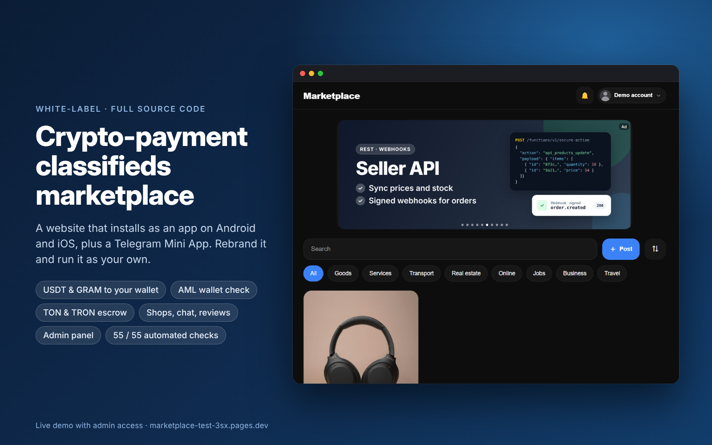
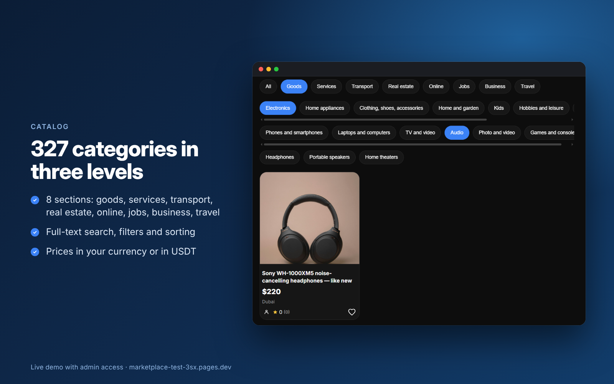
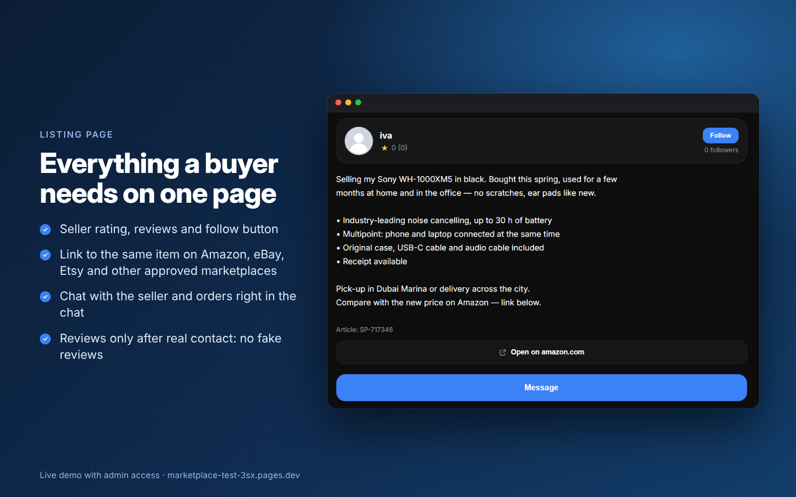
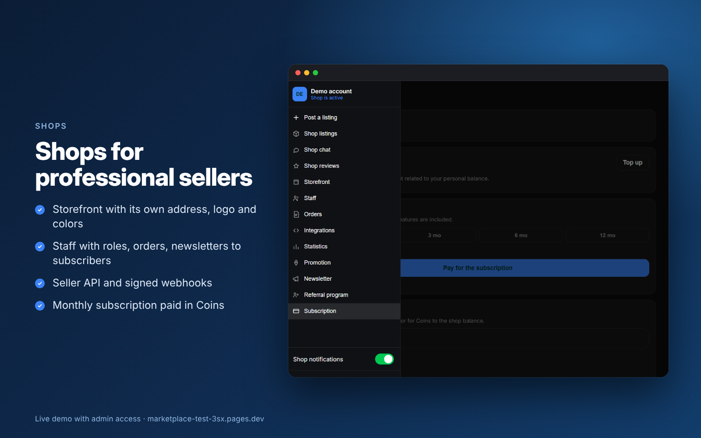
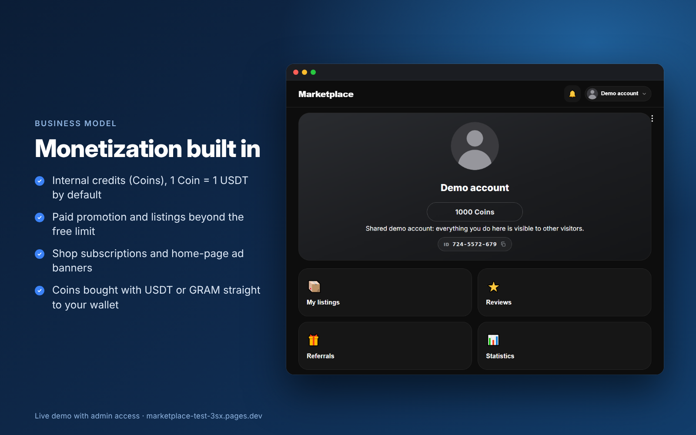

# Crypto-payment classifieds marketplace — white-label source code

A ready-to-launch classifieds marketplace that you rebrand and run as your own:
a website that installs as an app on Android and iOS (PWA), a **Telegram Mini App**,
**USDT and GRAM payments straight to your wallet** with an **AML wallet check**, and a
crypto **safe deal (escrow) on TON and TRON smart contracts**.

Built for markets where Telegram is the main messenger and crypto payments are allowed.

> **This repository is a showcase. It contains no source code.**
> The full source code is delivered after purchase — see [Price and terms](#price-and-terms).

## Try it

| | |
|---|---|
| **Live demo with admin access** (one click, no registration) | [Open the demo](https://marketplace-test-3sx.pages.dev/?demo=XZbdZtN23SnOjBvA1QQ8vf1gR2hHlCtl) |
| **Telegram Mini App** | [@Market_demo_app_bot](https://t.me/Market_demo_app_bot) — open the bot and tap **Open** |
| **Full description, test report, user guide and FAQ** | [marketplace-test-3sx.pages.dev/for-sale](https://marketplace-test-3sx.pages.dev/for-sale) |

The demo runs on a shared account that is also an administrator, so you can try both
the buyer's and the operator's side. Actions that would affect other visitors (bans,
roles, money operations) are turned off for the shared account.

## Screenshots

| | |
|---|---|
|  |  |
|  |  |

## Features

**For buyers and sellers**
- Feed with ad banners and stories, 327 categories in 3 levels, full-text search, filters and sorting
- Listings with up to 10 photos, price in your currency or in USDT, link to the same item on Amazon, eBay, Etsy and other approved marketplaces
- Three kinds of listings: physical products, services with booking and calendar sync (Google, Outlook, iCloud), digital products
- Real-time chat with photos and files, orders right in the chat, stock with reserved quantities
- Reviews protected from fakes: only after real contact, one per seller, the seller can dispute, an administrator decides
- Sign-in without passwords: automatic in Telegram, one-time e-mail code or Google on the website

**For shops**
- Storefront with its own address, logo, banner and colors
- Staff with roles, orders, newsletters to subscribers, shop ads in the feed, statistics
- Seller API with tokens and signed webhooks to sync prices, stock and orders

**For the operator**
- Admin panel with two-factor login: moderation queue, reports, review disputes, ad banners, user cards with history
- Moderation: prohibited-word lists and a moderator queue; automatic AI mode with an OpenAI key; edited listings are checked again
- Protection against bots: device fingerprint freezes mass accounts, posting limits, Cloudflare Turnstile
- Content strikes and automatic freezes for repeat offenders, bans, verified-seller badge
- 26 scheduled jobs that expire and clean up data by themselves

## Crypto

- Users buy internal credits with **USDT or GRAM on TON** and **USDT on TRON**, straight to your wallet — no payment processor
- Every paying wallet is screened with **MistTrack AML** before any money is sent; risky wallets are refused
- **Safe deal (escrow)** between users on TON and TRON smart contracts: claims, an arbiter, automatic payout by deadline
- Optional connector for the **NOWPayments** gateway

## Business model

Built-in monetization through internal credits (1 credit = 1 USDT by default):
listings beyond the free monthly limit, paid promotion, monthly shop subscriptions,
shop ads in the feed, home-page banners at your own price, an arbitration fee for safe
deal disputes, and a referral program. Every price and limit is documented with the
place in the code where it can be changed.

## Quality

- **55 automated end-to-end checks** of the whole installation, all passing — the test function and the report are included
- Escrow contracts with their own test suites: TON in a sandbox, TRON in Hardhat and on a local TRON node with the real USDT contract
- Row-level security on every table; the browser never writes to the database directly — every action goes through one server gateway that checks rights and limits
- Documentation: installation guide, business model with every price and limit, developer guide that maps each feature to its code, server actions and tables

The escrow contracts have not had an independent audit yet: keep deal limits low until you order one.

## Stack

| Part | Technology |
|---|---|
| Front end | Plain HTML, CSS and JavaScript — no framework, no build step |
| Back end | Supabase: Postgres, Auth, Storage, Realtime, Edge Functions (TypeScript on Deno), pg_cron |
| Hosting | Cloudflare Pages (or any static hosting), one Cloudflare Worker for link previews, SEO pages and sitemap |
| Smart contracts | Tact (TON), Solidity (TRON) |
| Integrations | Telegram Mini Apps, TON Connect, WalletConnect, TonAPI, TronGrid, MistTrack, OpenAI, Web Push (VAPID), Google OAuth, Cloudflare Turnstile, NOWPayments |

A test installation runs on free plans.

## Price and terms

**5,000 USDT** (TON or TRC-20).

**Included**
- The complete source code with full rights to use, change, rebrand and run it as your own marketplace, with no royalties
- Help with installation on your own Supabase and Cloudflare accounts, if you want it
- Help connecting every feature: crypto payments to your wallet, AML check, escrow, AI moderation, push notifications, Google sign-in, Cloudflare Turnstile

**Not included:** development of new features.

The source code itself may not be resold. Non-exclusive: the same code is offered to other buyers.

## Contact

E-mail: **spotgram.support@gmail.com**
